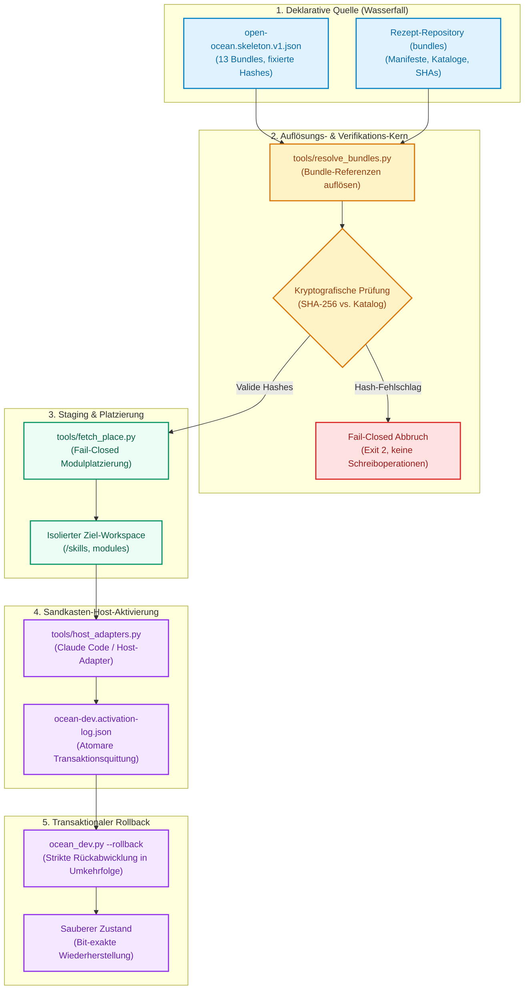
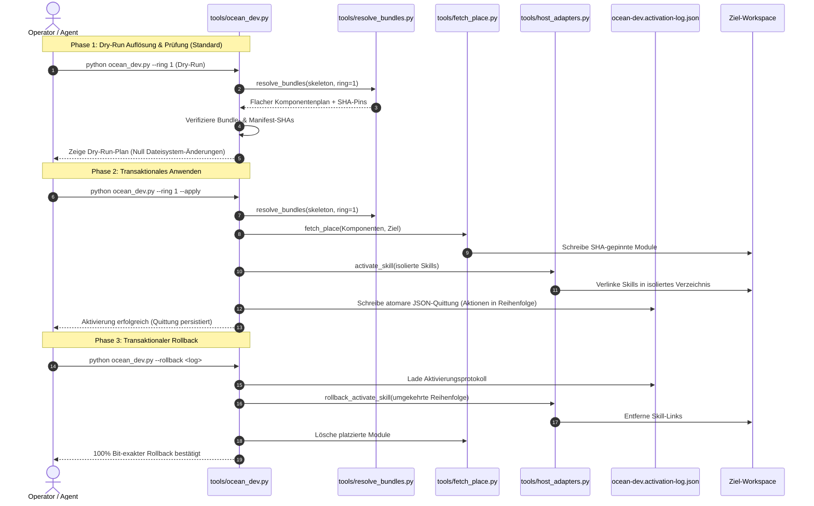
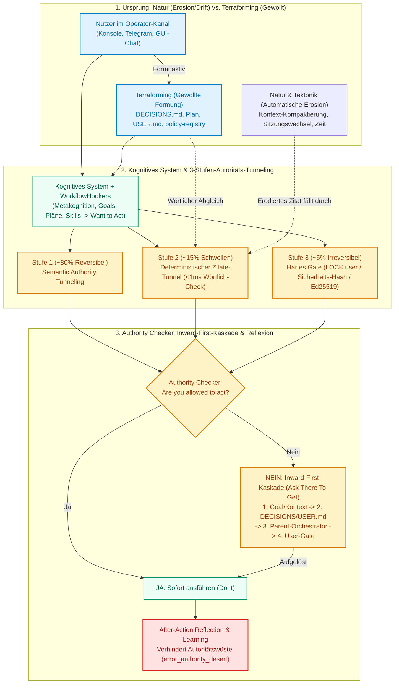
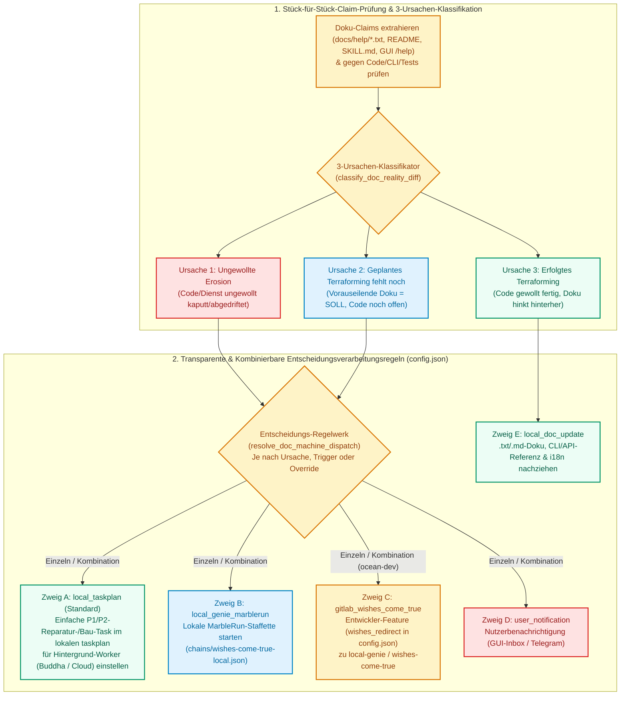
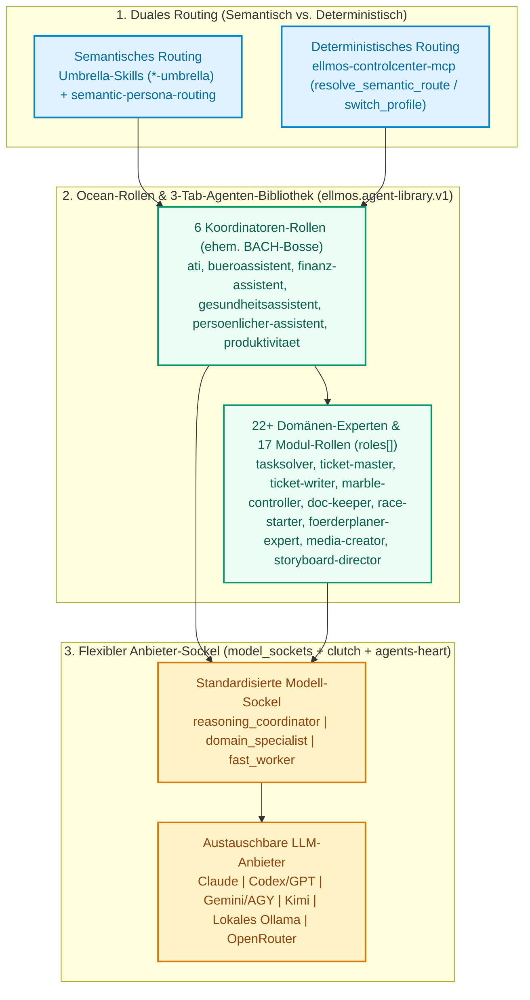

[](https://youtu.be/S-oiYUg4GLA)

# open-ocean

**Free the ocean.**

Ein lokaler, prüfbarer Installer, der KI-Agentensysteme aus deklarativen Rezepten zusammensetzt —
das kostenlose Community-System des ellmos-Ökosystems.

*[English](README.md)*

Kandidatenintegration: Der [gemeinsame GUI-Verbrauchervertrag](architecture/GUI-CONSUMER.md)
beschreibt gepinnte Astro-Releases, native Leseadapter und offene Laufzeitabnahmen.

[](pyproject.toml)
[](https://www.python.org/)
[](https://github.com/ellmos-ai/open-ocean/actions/workflows/ci.yml)
[](tests/)
[](https://github.com/ellmos-ai/open-ocean)
[](https://github.com/astral-sh/ruff)
[](SECURITY.md)
[](SECURITY.md)
[](LICENSE)
[](llms.txt)
[](CHANGELOG.md)
[](https://github.com/ellmos-ai)
[](https://github.com/open-bricks)

> **Schnellnavigation:**
> 1. [Was es ist](#was-es-ist)
> 2. [Woher es kommt](#woher-es-kommt)
> 3. [Systemarchitektur](#systemarchitektur)
> 4. [Installations- und Rollback-Lebenszyklus](#installations--und-rollback-lebenszyklus)
> 5. [Garantien](#garantien)
> 6. [Schnellstart und CLI-Nutzung](#schnellstart-und-cli-nutzung)
> 7. [Was im Repository liegt](#was-im-repository-liegt)
> 8. [Status](#status)
> 9. [Mitmachen](#mitmachen)
> 10. [Verwandte Projekte](#verwandte-projekte)
> 11. [Sicherheitsrichtlinie](#sicherheitsrichtlinie)
> 12. [Lizenz](#lizenz)
> 13. [LLM-Kontext und Discovery](#llm-kontext-und-discovery)

> [!NOTE]
> Maschinenlesbarer Kontext für KI-Agenten: [`llms.txt`](llms.txt). Sicherheitsrichtlinie: [`SECURITY.md`](SECURITY.md). Drittanbieter-Lizenzen: [`THIRD_PARTY_LICENSES.md`](THIRD_PARTY_LICENSES.md). Änderungen: [`CHANGELOG.md`](CHANGELOG.md).

> **Frühes Stadium.** Der Installer läuft auf den Rechnern der Entwickler durchgehend. Ein
> getaggtes Release gibt es noch nicht — siehe *[Status](#status)*.

---

## Was es ist

open-ocean liest **Rezepte** — Bundle-Manifeste aus dem öffentlichen Repository
[`ellmos-ai/bundles`](https://github.com/ellmos-ai/bundles) — und macht daraus eine lauffähige
lokale Installation. Jede Komponente wird vor dem ersten Schreibzugriff gegen einen
SHA-256-Pin geprüft, in einen isolierten Arbeitsordner gelegt, dort aktiviert und so
protokolliert, dass sich die ganze Installation exakt zurückrollen lässt.

- **Offline gebaut** — keine Telemetrie, keine Netzzugriffe außer den gepinnten Abrufen, die du anforderst.
- **Erst Probelauf** — geschrieben wird nur mit `--apply`.
- **Fail-Closed** — eine Hash-Abweichung stoppt den Lauf vor dem ersten Schreibzugriff.
- **Umkehrbar** — jede Änderung wird protokolliert und in umgekehrter Reihenfolge zurückgenommen.

open-ocean ist der offene Teil des größeren ellmos-Systems. Einige Teile dieses Systems sind
privat oder kommerziell und nicht in diesem Repository enthalten.

---

## Woher es kommt

Das Ökosystem benennt seine Schichten nach Wasser, weil das Bild erklärt, wie die Teile
zusammenhängen:

| Begriff | Was es ist |
|---|---|
| **Strom / Wasser** | die Arbeit selbst — Daten, Aufgaben und Ergebnisse, die durch alles fließen |
| **Bach / Rinnsal** | die gewachsenen Ströme: [BACH](https://github.com/ellmos-ai/bach), das ursprüngliche persönliche Gesamtsystem, und [Rinnsal](https://github.com/ellmos-ai/rinnsal), sein schlanker Nachfolger |
| **Wasserleitungen** | dasselbe Wasser, gezähmt und modularisiert — wiederverwendbare Module und Bundles |
| **Wasserfall** | die deklarative Quelle: die Rezepte und Kataloge, aus denen alles gebaut wird |
| **Ozean** | wo die Ströme ankommen; die Linie verläuft Bach → Rinnsal → Ozean |
| **open-ocean** | der Teil des Ozeans, der allen gehört — dieses Repository |

Aus dem Bild folgt eine Regel: Umbauen ändert das Bett, nie das Wasser. Wer eine Fähigkeit
aus BACH in Module verlegt, muss erhalten, was sie tut.

---

## Systemarchitektur

Das folgende Diagramm zeigt, wie deklarative Rezepte aus dem vorgeschalteten Wasserfall in verifizierbare, isolierte und transaktional rückrollbare lokale Installationen überführt werden:



---

## Installations- und Rollback-Lebenszyklus

Jeder Ausführungslebenszyklus folgt einem deterministischen Drei-Phasen-Pfad, der versehentliche Änderungen am Host-System physisch ausschließt:



---

## Garantien

| ID | Invariante | Beschreibung | Durchsetzungs-Mechanismus |
|---|---|---|---|
| `INV-LOCAL-01` | **100% Local-First & Zero-Egress** | Alle Manifest-Auflösungen, Hash-Prüfungen, Modulplatzierungen und Aktivierungen laufen offline ohne Telemetrie. | Statische Codeanalyse (`test_zero_egress_and_offline_invariants`), reine Python-Standardbibliothek |
| `INV-TRANS-02` | **Transaktionaler Rollback** | Jede Schreiboperation unter `--apply` wird in `ocean-dev.activation-log.json` protokolliert und mit `--rollback` strikt in Umkehrfolge zurückgenommen. | `ocean_dev.py --rollback`, plattformübergreifend verifiziert auf macOS und Windows (`test_ocean_dev.py`) |
| `INV-DRY-03` | **Verbindliches Dry-Run-First** | Standardausführung der CLI ist rein lesend; Änderungen erfordern die explizite Angabe von `--apply`. | CLI-Argument-Parser, Standard-Schutzgatter |
| `INV-PIN-04` | **Kryptografisches SHA-256-Pinning** | Bundle-Manifeste und Komponenten müssen exakt mit den Katalog-Hashes übereinstimmen; Fail-Closed bei jeder Abweichung. | `resolve_bundles.py` SHA-Prüfung, sofortiger Exit-Code 2 |
| `INV-SAND-05` | **Sandkasten-Isolation bei Aktivierung** | Aktivierungen zielen auf `<workspace>/skills`, niemals auf produktive Agenten-Verzeichnisse (`~/.claude/skills`). | `host_adapters.py` Standardziel-Sicherheitsprüfung |
| `INV-PRIV-06` | **Keine Rechteausweitung (User-Mode)** | Alle Werkzeuge laufen ohne administrative Rechte im Standard-Benutzerkontext. | Normale Benutzerrechte, keine OS-Elevation-APIs |
| `INV-PLAT-09` | **Plattformübergreifende Parität** | Einheitliches Verhalten und normalisierte Pfadbehandlung unter Linux, Windows und macOS. | CI-Matrix auf GitHub Actions (`windows-latest`, `ubuntu-latest`, `macos-latest`) |
| `INV-SLA-10` | **48h Reaktions- & 5-Tage-Triage-SLA** | Schwachstellenmeldungen werden innerhalb von 48 Stunden bestätigt; Triage erfolgt verbindlich innerhalb von 5 Werktagen. | `SECURITY.md` Sicherheitsrichtlinie |

Die IDs sind feste Kennungen; die Nummern 07 und 08 waren interne Freigabe- und Paritäts-Gates
und gehören nicht mehr zu den öffentlichen Garantien.

---

## 📦 Download, Geführte Installation & Skalierung (`Rinnsal ↔ BACH ↔ Meer`)

Wer nach **Ocean** (oder **BACH**) sucht und sich für die Installation entscheidet, wird direkt aus der README zum **ELLMOS / Ocean Installer (`ellmos-installer`)** und zur aktuellen installierbaren Version für sein Betriebssystem geleitet:

| Betriebssystem | Primärer nativer OS-Installer | Optionaler App-Store-Kanal (Zusatzservice) |
|---|---|---|
| **Windows** | **`.exe` / `.msi` Geführtes Setup** | Microsoft Store (MSIX) |
| **macOS** | **`.dmg` / `.pkg` Universal-Installer** (Apple Silicon & Intel) | Mac App Store / Homebrew Cask |
| **Linux** | **`.AppImage` / `.deb` / `.rpm` Installer** | Flathub / Snap |

1. **Herunterladen & Starten (Hermes-inspirierte 4-stufige Menüführung von wichtig zu unwichtiger):** Du lädst den Installer für dein Betriebssystem herunter und startest ihn (`ellmos-installer onboarding`):
   - **Stufe 1 — Modelle, Subscriptions & API-Zugänge:** Lokale Modelle (**Ollama**) erkennen sowie Subscriptions und API-Keys (**Claude**, **Codex/OpenAI**, **Gemini**, **OpenRouter**, **Ollama Cloud**, **Kimi**) sicher im lokalen Keyring hinterlegen.
   - **Stufe 2 — Wichtige System-MCPs, Berechtigungs- & Autoritätseinstellungen:** Zentrale System-MCPs (**`ellmos-filecommander`**, **`ellmos-controlcenter-mcp`**, `codecommander`, `homebase`) sowie Arbeitsbaum-Zugriffsbereich (`sandbox | ocean | free`), Review-Modus und 5-stufige Eskalationsleiter einstellen.
   - **Stufe 3 — Connectoren:** **Telegram**, **WhatsApp**, **Discord** und **E-Mail-Bridge** direkt verbinden.
   - **Stufe 4 — Ausdehnung (`Rinnsal ↔ BACH ↔ Meer`), Plugins, weitere MCPs & Skills:** Individuelle Modul-Ausdehnung sowie optionale Plugins, MCPs und Skills auswählen.
2. **Bestandteile jederzeit nachinstallieren oder deinstallieren:** Dein Ocean bleibt jederzeit anpassbar. Über den Installer oder direkt aus der **System-GUI (`ellmos-system-gui`)** lassen sich Bestandteile (Module, Bundles, Skills) später jederzeit **nachinstallieren oder rückstandslos deinstallieren**.
3. **Einstiegsabhängiges Branding (`open-ocean` vs. `bach`):**
   - **Einstieg über `open-ocean`:** Du erhältst das reine **Ocean-Branding** in der System-GUI (`resolve_entry_point_brand("open-ocean")`) — das BACH-Branding entfällt vollständig.
   - **Einstieg über `bach`:** Du erhältst das **BACH-Branding**, bei dem **Ocean ebenfalls im Vordergrund der GUI steht**, BACH jedoch als kuratierte Version/Ausprägungsform von Ocean dargestellt wird (*„BACH — eine kuratierte Edition von Ocean"*, `resolve_entry_point_brand("bach")`).

### Zwei-Achsen-Modell: Individuelle Ausdehnung vs. Berechtigungs- & Systemstufen

- **Achse 1 — Individuelle Ausdehnung (`Rinnsal ↔ BACH ↔ Meer`):** Das öffentliche Ocean besitzt eine ausgewogene Standard-Ausdehnung an Modulen. Indem Module und Bundles abgewählt oder hinzugenommen werden, erhält jeder Nutzer sein individuelles Ocean:
  - **Rinnsal:** Schlanker Minimal-Ausbau (z. B. nur Gedächtnis- und Taskkern).
  - **BACH:** Kuratierter Alltags- und Desktop-Ausbau mit gemeinsamer GUI (`ellmos-system-gui`) für lokale und nicht-lokale Modelle.
  - **Meer:** Breit ausgebautes Mehrdomänen- und Multi-Agenten-System mit zahlreichen Fachbundles.
- **Achse 2 — Berechtigungs- & Systemstufen (`full-ocean` · `ocean-dev` · `ocean-admin`):**
  - **`full-ocean` (Installer-Zugangsstufe):** An den `ellmos-installer` gebundenes Berechtigungskonzept — der Installer erfüllt das Versprechen auf Zugang zum vollen Ocean, sofern berechtigt (für normale Nutzer alle öffentlichen Module; für berechtigte Personen zusätzlich nicht veröffentlichte Module über signierte `capability-grant.v1`-Grants).
  - **`ocean-dev` (Entwickler- & Diagnose-Ausbau):** Durchaus öffentliche Entwickler-, Prüf- und Bau-Module (`system-explorer`, `system-auditor`, `system-gap-master`, `ellmos-tests`, `module-gate`), die ein normaler Nutzer im Standard-Ausbau nicht zwingend mitinstalliert.
  - **`ocean-admin` (Betreiber- & Cluster-Ausbau):** Lukas' Gesamtsystem mit dem Mac Studio als 24/7-Leader, Workstations, unveröffentlichten privaten Forschungs-/Fachmodulen und `.SYNC`.

---

## 🧭 Kern-Governance: Identität & Autoritätsfluss, 3-Ursachen-Dokumentationsmodell & Transparente Entscheidungsverarbeitungsregeln

Das Verhalten von **BACH** und **Ocean** wird durch **transparente, einsehbare und vom Nutzer einstellbare Entscheidungsverarbeitungsregeln (`decision_processing_rules`)** bestimmt. Nichts geschieht als Blackbox: Jede Autoritätsprüfung, jede Klassifikation einer Doku-Abweichung und jeder ausgelöste Aktionszweig erzeugt eine nachvollziehbare Regelspur (`decision_rule_trace`).

### 1. Identität, 3-Stufen-Autoritäts-Tunneling & Schutz vor der „Autoritätswüste“

- **Identität vs. Autorität:** **Identität** entsteht durch Kontobesitz auf dem Gerät und die einmalige Registrierung von Gerät/Kanal (Geheimnisse liegen unsichtbar im lokalen Keyring). **Autorität** fließt vom Nutzer über **Operator-Kanäle** (Konsole, Telegram, System-GUI-Chat) zweckgebunden an beauftragte Subagenten und Hintergrund-Worker.
- **Natur (Automatische Erosion & Drift) vs. Terraforming (Gewollte Formung):** Erosion und Drift entstehen von selbst durch die reale Systemnutzung (Kontext-Kompaktierung, Sitzungswechsel, Zeitverlauf) — es gibt keinen künstlichen Verfalls-Cronjob, der gültige Entscheidungen entwertet. Wenn wir `DECISIONS.md`, `AKTUELLER-PLAN.md`, `USER.md` oder Code bewusst ändern, ist das **Terraforming**: überholte Einträge werden direkt an der Quelle als `superseded` markiert.
- **3-Stufen-Tunneling & Inward-First-Kaskade (`open-ocean/tools/escalation_ladder.py`):**
  1. **Stufe 1 — Semantisches Authority-Tunneling (~80 % reversibler Alltag):** Schnelle Ausführung innerhalb eines aktiven Goals/Plans (`authority_ref`, `active_goal_or_plan_id`), verhindert unnötige Rückfragen trotz kontextgesichertem Userwillen (**Fehlerklasse `error_authority_desert` / Autoritätswüste**).
  2. **Stufe 2 — Deterministischer Zitate-Tunnel (~15 % Schwellen-Übergänge, `ellmos-authority-evidence`):** Extrahiert aus NemoFold (`evidence.py`); prüft in `< 1 ms` (`validate_quote_tunnel_evidence`), ob das mitgelieferte `literal_quote` **wortwörtlich** und nicht-`superseded` in der Originalquelle (`DECISIONS.md`, `transcript.jsonl`, `AKTUELLER-PLAN.md`) steht.
  3. **Stufe 3 — Harte Kryptografie- & Lock-Gates (~5 % irreversibel / Hochrisiko):** Durchgesetzt über `lock_status.py` (`LOCK.user.*`), gehashte Sicherheitsfrage (`ellmos-installer`) und Ed25519-`capability-grant.v1`-Zertifikate.



### 2. Das 3-Ursachen-Dokumentationsmodell & Einstellbare Entscheidungsverarbeitungsregeln (`config/doc_machine.config.json`)

Stellt die automatisierte Dokumentationsprüfung (`ellmos-doc-keeper` + NemoFold-Claim-Nachbelegung) eine Abweichung zwischen Doku (`docs/help/*.txt`, `README.md`, `SKILL.md`, GUI `/help`) und gemessener Realität fest, überschreibt sie **niemals blind gewollte SOLL-Architektur**. Stattdessen klassifiziert `classify_doc_reality_diff()` den Diff deterministisch in **3 Ursachen**, und `resolve_doc_machine_dispatch()` wählt anhand transparenter, frei kombinierbarer **Entscheidungsverarbeitungsregeln** die Aktionszweige (`selected_branches`):

| Ursache (`classify_doc_reality_diff`) | Bedeutung | Transparente Aktionszweige (`selected_branches` — einzeln oder kombiniert einstellbar) |
|---|---|---|
| **1. `unintended_erosion`** *(Ungewollte Erosion / Drift)* | Doku beschreibt das richtige Verhalten, aber Code/Dienst ist ungewollt kaputtgegangen oder abgedriftet. | **SOLL in Doku bewahren** + IST-Warnhinweis setzen + Standard-Kombination **`["local_taskplan", "user_notification"]`** (stellt P1-Reparatur-Task für Hintergrund-Worker ein und benachrichtigt Nutzer; optional kombinierbar mit `local_genie_marblerun` oder `gitlab_wishes_come_true`). |
| **2. `planned_terraforming_pending`** *(Fehlendes / geplantes Terraforming)* | Vorauseilende Doku: beschreibt gewolltes SOLL aus Plan/`DECISIONS.md`, das im Code noch nicht fertig ist. | Taskstatus in `taskplan` prüfen/anpassen bzw. P2-Umsetzungs-Task über **`["local_taskplan"]`** anlegen + in der Doku sauber als **SOLL (mit Task-ID)** vs. **IST** trennen. |
| **3. `completed_terraforming_doc_lag`** *(Erfolgtes Terraforming mit lückenhafter Doku)* | Vorauseilender Code: wurde gewollt weiterentwickelt (Commit/PR/`task_status=done`), Doku hinkt hinterher. | Zweig **`["local_doc_update"]`**: zieht `.txt`-CLI-Help, `.md`-Doku, CLI/API-Referenzen und Übersetzungen (`de/en/es/ja/ru/zh`) automatisch lokal nach. |




### 3. Boss- & Experten-Rollen in Ocean: Dual-Routing, Flexible Anbieter-Sockel & die 3-Tab-Agenten-Bibliothek (`ellmos.role-socket-catalog.v1`)

In Ocean bleiben die bewährten BACH-**Boss-Agenten (Koordinatoren)** und **Domänen-Experten** als **anbieterunabhängige Rollen (`roles[]`)** mit **dualem Routing** und **flexiblem Anbieter-Sockel (`model_sockets` über `clutch` + `agents-heart`)** erhalten:

- **Duales Routing (`semantic_umbrella_and_persona` + `deterministic_controlcenter_mcp`):**
  - **Semantisches Routing:** Umbrella-Skills (`projekt-pipeline-umbrella`, `therapie-umbrella`, `selbstmanagement` usw.) und `semantic-persona-routing` (`persona_router.py`) wählen kontextsensitiv die passende Koordinatoren-/Experten-Rolle samt Skill-Set.
  - **Deterministisches Routing:** `ellmos-controlcenter-mcp` (`controlcenter_resolve_semantic_route`, `controlcenter_switch_profile`) übernimmt das regelgebundene, deterministische Routing und Profil-Umschalten.
- **Flexibler Anbieter-Sockel (`reasoning_coordinator`, `domain_specialist`, `fast_worker`):** Rollen sind von festen Modell-Anbietern entkoppelt und lassen sich zur Laufzeit flexibel mit **Claude (`claude`)**, **OpenAI/Codex (`codex`)**, **Gemini/Antigravity (`agy`)**, **Kimi (`kimi`)**, **lokalem Ollama (`ollama`)** oder **OpenRouter (`openrouter`)** bestücken.
- **3-Tab-Agenten-Bibliothek (`/agenten/bibliothek`, `build_full_agent_library_catalog`):** Vereint die 6 Koordinatoren-Rollen (`ati`, `bueroassistent`, `finanz-assistent`, `gesundheitsassistent`, `persoenlicher-assistent`, `produktivitaet`), 22+ Domänen-Experten und **17 explizite Modul-Rollen (`roles[]`)** aus 9 Ocean-Modul-Repositories (`task-master`, `ticket-master`, `MarbleRun`, `system-auditor`, `compare-race`, `ellmos-installer`, `foerderplaner`, `ai-media-editor`, `clip-storyboard-director`) in Tab 1 (`templates`), Tab 2 (`prompt_agents`) und Tab 3 (`chains`).



---

## Schnellstart und CLI-Nutzung

open-ocean braucht Python 3.10+ und `cryptography>=41` (für die Ed25519-Belegprüfung von
`ocean inspect`).

```bash
# Installer und öffentliche Rezepte holen
git clone https://github.com/ellmos-ai/open-ocean.git
git clone https://github.com/ellmos-ai/bundles.git
cd open-ocean
pip install -e .

# 1. Probelauf für die Ring-1-Bundles (keine Schreibzugriffe)
python tools/ocean_dev.py --bundles-root ../bundles --ring 1

# 2. Transaktionale Aktivierung in einen isolierten Arbeitsordner
python tools/ocean_dev.py --bundles-root ../bundles --ring 1 --apply

# 3. Rollback anhand des erzeugten Aktivierungsbelegs
python tools/ocean_dev.py --rollback <workspace>/ocean-dev.activation-log.json
```

Das Skelett verweist auf 13 Bundles in zwei Ringen — den funktionalen Kern (`--ring 1`) und die
Breite drumherum (`--ring 2` oder `all`).

Für ein laufendes System fasst `ocean.py` dieselben Schritte in einen Produkt-Lebenszyklus:

```text
python ocean.py plan <kompositions-argumente>
python ocean.py up <kompositions-argumente> --apply
python ocean.py start --workspace <lokale-sandbox>
python ocean.py status --workspace <lokale-sandbox>
python ocean.py inspect --workspace <lokale-sandbox> ...   # nur lesend, siehe architecture/OCEAN-INSPEKTION.md
python ocean.py user add --workspace <lokale-sandbox> --username <name> --email <adresse>
python ocean.py down --workspace <lokale-sandbox>
```

Alle Argumente zeigt `python ocean.py --help` samt Unterbefehls-Hilfe. Passwörter werden ohne
Echo abgefragt und nie als Prozessargument übergeben (`--password-stdin` für Automatisierung).

---

## Was im Repository liegt

```
ocean.py                        Lebenszyklus-CLI (plan/up/start/status/inspect/user/down)
tools/
  ocean_dev.py                  ein Einstiegspunkt: Resolve -> Verify -> Fetch/Place -> Activate,
                                standardmäßig Probelauf, --apply für echte Schreibzugriffe, --rollback
  resolve_bundles.py            Bundle-Verweise -> flacher, hash-geprüfter Komponentenplan
  check_doc_loop_contract.py    Doku-Regelkreis-Vertrag und Belegketten-Prüfer
  check_plugin_activation_contract.py  Plugin-Aktivierungsvertrag und Aktivierungsbeleg-Prüfer
  fetch_place.py                SHA-gepinnte Modulplatzierung, Fail-Closed
  host_adapters.py              anbieterneutrale Skill-Aktivierung und -Rückbau (Claude Code als Referenz)
  source_pins.py                Prüfung der Quellherkunft vor Resolve/Fetch
  ocean_lifecycle.py            Lebenszyklus plan/up/status/down/user
  runtime_supervisor.py         authentifizierter Loopback-Supervisor
architecture/
  open-ocean.skeleton.v1.json   die Rezepte, die dieses System konsumiert, per Hash gepinnt
  INSTALLER-TARGET.md           Installer-Vertrag und Invarianten
  OCEAN-INSPEKTION.md           nur lesender Inspektionsadapter
  OCEAN-DOKU-REGELKREIS.md      Doku-Regelkreis-Vertrag (Zustände, Belege, Regeln)
  PLUGIN-AKTIVIERUNG.md         Plugin-Aktivierungsvertrag (Zustände, Belege, Regeln)
  BACH-EXTRAKTIONSROADMAP.md, bach-*.json
                                Verträge für das Verlegen von BACH-Fähigkeiten in Module
tests/                          Offline-Testsuite
```

Das Skelett **verweist** auf Rezepte; hier wird kein Manifest kopiert, darum kann dieses
Repository nie von der Rezeptquelle abdriften.

---

## Status

Die erste Hybrid-Ressourcenstrecke steht als mitgelieferte `ocean_resources`-API und
JSON-Manifest über `python -m ocean_resources` bereit. Der ausdrückliche Befehl
`fixture-demo` prüft Compute → Checkpoint/Exit → Chat → fortgesetzten Compute in eigenem
temporärem Zustand. Reale Adapter bleiben HOLD; produktive Queues, Modelle und BACH-Zustand
werden nicht verändert. Der [Steckplatzverteiler-Vertrag](architecture/STECKPLATZVERTEILER.md)
beschreibt Schreiber-, Mess-, Kompatibilitäts- und Rolloutgates.

Die [allgemeine Pipeline-Beobachtung](architecture/PIPELINE-HOST.de.md) umfasst Research,
Services, Medien und Builds mit ursprünglichen Executorverweisen. `python -m ocean_resources host`
misst RAM, Speicherdruck und Plattenplatz lesend; `catalog` und `shadow` prüfen ausdrückliche
Pipeline-Projektionen. Zentralpräferenz für schwere oder wiederkehrende Arbeit berücksichtigt
Hostfähigkeiten und Reserven. Messungen und Routingvorschläge erteilen keine Starterlaubnis.

Der optionale [native Kapazitätsport](architecture/PIPELINE-CAPACITY.de.md) misst
CPU-Zählerdifferenzen und zieht ausdrückliche RAM-, CPU- und Diskreserven ab. `capacity`
liefert lesend einen Kandidaten oder HOLD, ohne Lastprofile oder Starts freizugeben.
Der [Executor für eigene Prozesse](architecture/PIPELINE-EXECUTOR.de.md) stellt den
gesonderten geprüften Checkpoint-/Exit-/Resumepfad für ausdrücklich konfigurierte Kinder bereit.

Die [Host-Fokussteuerung](architecture/PIPELINE-CONTROLLER.de.md) ergänzt ausdrückliches
Polling, sichere Chatübergabe, Rückgabe bei Inaktivität, Hintergrundlaufzeit und begrenzte
Operatorbefehle über dieselben Ports. Native Executoren behalten ihre Jobs; produktive
Zulassung und Dienstaktivierung bleiben gesonderte Abnahmen.

Ausdrücklich konfigurierte [geprüfte Lastprofile](architecture/PIPELINE-PROFILES.de.md)
binden die CPU-Prozesszuteilung an gepinnte Mess-/Policydateien, den konkreten
Befehl sowie Host und Architektur. `profiles` prüft diese Eingaben lesend.
Abgelaufene Profile sperren neue Starts; Checkpoint und sichere Rückgabe bleiben möglich.

Der optionale [gemeinsame Hosttransport](architecture/PIPELINE-TRANSPORT.de.md)
verbindet getrennte native HostClient-Prozesse mit einem ausdrücklich gestarteten
HostService. Clientrechte und Writerbindung erhalten Ressourcen- und
Lifecyclegates. Die Installation startet oder konfiguriert keinen Hostdienst.

- **Läuft:** Resolve, Verify, SHA-gepinntes Fetch/Place, isoliertes Activate, Rollback und der
  `ocean.py`-Laufzeit-Lebenszyklus, getestet unter Windows, Linux und macOS.
- **Offen:** eine Neuinstallation auf einem Rechner außerhalb der Entwicklungsumgebung und die
  funktionale Abdeckung dessen, was BACH heute kann.
- **Noch nicht:** ein getaggtes Release. Was sich wann geändert hat, steht in [`CHANGELOG.md`](CHANGELOG.md).

---

## Mitmachen

Issues und Pull Requests sind willkommen. Vor einem PR bitte die Offline-Prüfungen laufen lassen:

```bash
pytest -ra -v
ruff check .
python -m compileall -q .
```

GitHub Actions prüft alle Tests, die nicht mit slow markiert sind, unter Linux, Windows und macOS mit Python 3.10 bis 3.13. In jeder OS/Python-Zelle sammelt ein Plan-Job das vollständige Modul tests/test_python_packages.py und teilt seine exakten Test-IDs deterministisch in sechs nicht leere Shards auf. Jeder Shard sammelt das Modul erneut und prüft die vollständige ID-Gleichheit sowie Run, Attempt, Commit, Modul- und pyproject-Hashes, Betriebssystem, Python- und pytest-Version, bevor er seine zugewiesenen IDs ausführt. Fehlende oder abweichende Pläne schlagen geschlossen fehl. Die Shard-Jobs behalten das Zeitlimit von 30 Minuten; höchstens zwölf Hosted Runner laufen gleichzeitig. Der schnelle Job lässt genau dieses Modul aus. Der bestehende `tests`-Check wartet auf alle Plan- und Shard-Jobs und schlägt fehl, wenn einer davon fehlschlägt oder abgebrochen wird; damit bleibt der bisherige Branch-Protection-Pflichtcheck wirksam. Die vorhandene Integrationstestsuite mit slow bleibt unverändert ein eigener Job unter Ubuntu/Python 3.12. Ruff und die Bytecode-Kompilierung laufen weiterhin im schnellen Matrix-Job.

Die Suite (360 Tests bestanden, 297 übersprungen; Überspringungen hängen an optionalen gepinnten Checkouts und dem Betriebssystem — gemessen unter Windows, 2026-10-04) läuft ohne Netzzugriff. Die Dokumentation wird auf Englisch und
Deutsch nebeneinander gepflegt (`README.md` / `README_de.md`, `CHANGELOG.md` / `CHANGELOG_de.md`);
bitte beide aktualisieren. Sicherheitsprobleme bitte über den Kanal unten melden, nicht als
öffentliches Issue.

---

## Verwandte Projekte

| Repository | Rolle |
|---|---|
| [`ellmos-ai/bundles`](https://github.com/ellmos-ai/bundles) | Rezeptschicht: Bundle-Manifeste und Kataloge, die hier konsumiert werden |
| [`ellmos-ai/bach`](https://github.com/ellmos-ai/bach) | Das ursprüngliche Gesamtsystem, aus dem open-ocean hervorgeht |
| [`ellmos-ai/rinnsal`](https://github.com/ellmos-ai/rinnsal) | Schlanke lokale Agenten-Infrastruktur |
| [`ellmos-ai/coma`](https://github.com/ellmos-ai/coma) | Optionaler COMA-Sitzungsfallback für den Rollenstart, wenn die unified-gui-Konsole und task-master nicht verfügbar sind. |
| [`ellmos-ai/policy-registry`](https://github.com/ellmos-ai/policy-registry) | Maschinenlesbare Policies, Governance-Regeln und System-Gates |
| [`ellmos-ai/system-explorer`](https://github.com/ellmos-ai/system-explorer) | Systemweite Inspektion; Anbieter hinter `ocean inspect` |
| [`ellmos-ai/sqlite-transit-sync`](https://github.com/ellmos-ai/sqlite-transit-sync) | Konfliktfreie SQLite-Zustandsreplikation |
| [`ellmos-ai/decision-clicker`](https://github.com/ellmos-ai/decision-clicker) | Entscheidungsrouting mit Mensch in der Schleife |
| [`ellmos-ai/memoryhooker`](https://github.com/ellmos-ai/memoryhooker) | Sitzungskontext und Gedächtnis-Hooks für Agenten |
| [`ellmos-ai/workflowhooker`](https://github.com/ellmos-ai/workflowhooker) | Lebenszyklus-Hooks für Agenten-Workflows |
| [`ellmos-ai/ellmos-filecommander-mcp`](https://github.com/ellmos-ai/ellmos-filecommander-mcp) | Lokaler Dateisystem-MCP-Server |
| [`ellmos-ai/ellmos-codecommander-mcp`](https://github.com/ellmos-ai/ellmos-codecommander-mcp) | MCP-Server für Codeanalyse und Refactoring |
| [`ellmos-ai/ellmos-controlcenter-mcp`](https://github.com/ellmos-ai/ellmos-controlcenter-mcp) | MCP-Server für Werkzeugrouting und Profile |
| [`dev-bricks/DevCenter`](https://github.com/dev-bricks/DevCenter) | Modulare Entwicklerwerkzeuge und Workspace-Launcher |
| [`dev-bricks/CodeBox`](https://github.com/dev-bricks/CodeBox) | Sandbox und Snippet-Verwaltung |
| [`file-bricks/ExplorerPro`](https://github.com/file-bricks/ExplorerPro) | Dateiverwaltung und Verzeichnissynchronisation |
| [`doc-bricks/CleanMarkdown`](https://github.com/doc-bricks/CleanMarkdown) | Markdown-Bereinigung und Linkprüfung |

---

## Sicherheitsrichtlinie

Sicherheit und Datenintegrität unterliegen der verbindlichen Richtlinie in [`SECURITY.md`](SECURITY.md):
- **48-Stunden Reaktions-SLA**: Alle Sicherheitsmeldungen werden innerhalb von 48 Stunden bestätigt.
- **5-Werktage Triage-Zusage**: Detaillierte Auswirkungsanalyse und Behebungszeitplan innerhalb von 5 Werktagen.
- **Offizielle Sicherheitskontakte**:
  - `security@ellmos.ai`
  - `security@open-bricks.org`
  - Fallback: `support@lukasgeiger.com`, `lukas@open-bricks.org`
- **Sicherheits-Advisories**: [GitHub Security Advisories](https://github.com/ellmos-ai/open-ocean/security/advisories)

---

## Lizenz

Lizenziert unter der freien **MIT-Lizenz** ([`LICENSE`](LICENSE)).
Drittanbieter-Entwicklungswerkzeuge und deren Lizenzen sind in [`THIRD_PARTY_LICENSES.md`](THIRD_PARTY_LICENSES.md) dokumentiert.

---

## Pakettransaktionen für eine bestehende Python-Umgebung

`tools/python_packages.py` gehört zur vorhandenen Ocean-Transaktionsengine. Die Operation
verwendet eine bestehende physische PEP405-Umgebung; sie legt keine Venv an und adoptiert
keinen Provider. Der Operator wählt die vertrauenswürdige Profilquelle über
`OCEAN_PYTHON_PROFILES_ROOT`. Anfragen binden nur `profile_id`, den rohen SHA-256 des Profils,
gepinntes Wheelmaterial und deklarierte Entry Points. Ziel und Artefaktwurzel stammen aus
diesem Profil. Das abgeleitete Venv-Installationsschema wird getrennt von den isolierten
Interpretermessungen ausgewiesen; Site-Hooks werden nicht importiert.

Die Planung prüft die Offline-Abhängigkeiten, vorhandene Dateieigentümer, Rückwärtsabhängigkeiten
und den Vorzustand. Apply verwendet eingefrorene, hashgeprüfte Wheelbytes. Verify misst physische
Distributionsmetadaten, RECORD, Provenienz und Entry Points, ohne Paketcode zu importieren.
Datei-, Archiv-, JSON- und Prozessausgaben werden begrenzt aufgenommen; Spezialdateien und
Identitätsdrift werden abgewiesen. Bestehende Editable-/Legacy-Distributionen sowie unvollständige
oder geteilte Eigentümerschaften stoppen die Operation. Eine native Editable-Umstellung braucht
einen eigenen Plan.

Standalone-CLI und konsumierender Installer verwenden denselben Venv-Mutex über die gesamte
Mutation und Journalfinalisierung. Der Installer konsumiert die verifizierten Original-Core-
Exports im selben Prozess. POSIX-Pip erbt dieselbe gesperrte Dateibeschreibung und hält die
Sperre auch nach dem Tod des Controllers. Unter Windows 10+ ist der Writer bereits bei der
Prozesserzeugung einem Kill-on-close-Job zugeordnet, bevor sein primärer Thread fortgesetzt
wird. Fehlende Kernelunterstützung stoppt den Paketwriter; es gibt keinen ungeschützten Fallback.

`--inspect-python-package-recovery` erfasst die aktuellen Plan-/Journal-/Profil-/Executor-/
Zielbindungen. `--reconcile-python-packages` kann einen vollständig gemessenen Nachzustand
finalisieren, ohne Pip erneut auszuführen. Ein partielles Apply oder unterbrochenes Rollback
braucht eine frische Recovery-CAS und den vorhandenen extern signierten Rollback-Grant des
aufrufenden Installers. Unbekannte Pfade bleiben ein Reparaturgate. Planungsbelege, Source-Review
und synthetische QA sind getrennt von Native-Apply, Freigabe, Grants und Laufzeitabnahme.
Installer-Bootstrap und Dienstumschaltung bleiben eigene Scopes.

## LLM-Kontext und Discovery

Für KI-Programmieragenten und automatisierte Discovery gibt es eine maschinenlesbare
Zusammenfassung mit Befehlsindex in [`llms.txt`](llms.txt).

## Portable Agentenstarter

`starters/windows/` enthält START, SYSTEM-AUDITOR, TICKET-MASTER, PINGPONG und MULTI-BOT als `.bat`-Dateien; `starters/posix/` enthält die Shell-Dateien. Das Wheel liefert sie unter `share/open-ocean/starters/` mit. Sie verwenden das vorhandene TASKPLAN-Startcenter und die Rollenverträge der Module. Zuerst die geprüfte TASKPLAN-Version mit Startcenter und die optionalen Rollenmodule installieren. Die Dateien setzen keine persönlichen Pfade, Konten, Modelle oder erweiterten Berechtigungen. Die Installation registriert oder startet keine Hintergrundjobs. START öffnet die Rollenauswahl. PingPong benötigt einen ausdrücklichen Sync-Root und eigenen Slot und unterstützt seine geprüften Codex-/Claude-Adapter. MULTI-BOT verwendet das öffentliche githubbot-core-Paket. Für Vorschauen `--dry-run --provider codex` übergeben; fehlende Module liefern einen Installationshinweis.


## Pakettests & Deterministisches Sharding

Damit jede CI-Matrix-Zelle deutlich unter dem Job-Timeout von 20 Minuten bleibt (`#2195`, `#3494`, `#3495`), nutzt die Testsuite ein zustandsfreies deterministisches Shard-Verfahren (`K = 4`):

```text
shard(nodeid) = int(sha256(nodeid)[:8], 16) % K
```

Einen einzelnen Shard lokal reproduzieren:

```bash
python -m pytest -q -m "not slow" --shard-index=0 --shard-count=4
```
