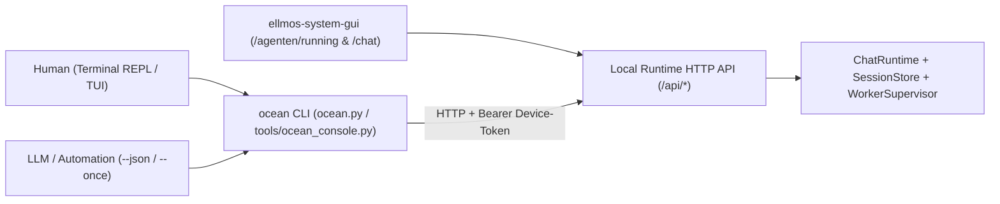

# OCEAN API + CLI Console (`ocean console` / `ocean chat`) — Architecture & Implementation Plan

**Status:** Plan initiated (2026-11-09)
**Reference:** Rule 4 (`API + CLI + GUI` — Dual operability for humans and LLMs), analog to `bach` CLI, `claude` (Claude Code) and `agy` (Antigravity CLI).

---

## 1. Target Vision & Core Principle (Dual API + CLI Contract)

Every capability of the OCEAN console is provided simultaneously through two synchronized channels:

1. **Local HTTP/JSON API** on the running OCEAN/BACH runtime server (default port `8810` or `8000` in BACH core) with identical request/response schemas for Web GUI (`ellmos-system-gui`), CLI, and other agents.
2. **Command Line & Interactive Console (`ocean` CLI)** in `ocean.py` or `tools/ocean_console.py`:
   - **Interactive REPL/TUI mode** (`ocean chat` / `ocean console`) for human operators in the terminal (with slash commands, live tool output, session switching, and agent selection).
   - **Non-interactive single-shot & JSON mode** (`ocean chat --once "..." --json`, `ocean agents list --json`, `ocean sessions show <id> --json`) for LLMs, scripts, and automations.



---

## 2. Planned CLI Subcommands (`ocean`)

Extension of `ocean.py` with four operational subcommands (complementing existing lifecycle commands `up`, `start`, `down`, `status`, `inspect`, `gui`, `task`, `stack-status`):

### 2.1 `ocean chat` (Alias: `ocean console`)
Interactive terminal console (similar to `claude` or `agy`) and single-shot execution for scripts/agents.

```bash
# Start interactive REPL session with default agent (buddha_chat)
ocean chat

# Chat directly with a specific agent or cloud/background worker
ocean chat --agent worker-354b7ca0
ocean chat --agent buddha_always_on
ocean chat --agent entwickler

# Load existing session (snapshot ID) and seamlessly continue in terminal (fork / in-place)
ocean chat --session 1842

# Single-shot mode for LLMs, pipelines, and shell scripts (optional --json)
ocean chat --agent recherche --once "Check current status of task #4047" --json
```

**Slash commands inside interactive `ocean chat` REPL:**
- `/agent <slot_or_worker_id>` — Switch active dialogue partner (core profile or background worker).
- `/sessions [limit]` — List recent saved sessions of current agent (`slot_id` filter).
- `/load <snapshot_id>` — Load a saved session transcript into console.
- `/fork [snapshot_id]` — Fork a loaded worker/archive session as new direct chat (`slot:<id>:<hex>`).
- `/resume [hint]` — Restart background worker with deterministic handover note (`_resume_zettel`) from current session.
- `/tools [on|off]` — Toggle display of tool executions (`tool` role) in terminal.
- `/status` — Show model binding, provider (`ollama`, `ollama-cloud`, `openrouter`), torch possession, and run status.
- `/new` — Start a fresh direct chat thread (`slot:<id>:<32-hex>`).
- `/exit` / `Ctrl+D` — Exit console cleanly.

---

### 2.2 `ocean agents`
Agent and background worker control via terminal (exact equivalent to tiles on `/agenten/running`).

```bash
# Display all core agents and background workers grouped by status (Ready, Running, Paused, Error)
ocean agents list [--status ready|running|paused|error] [--json]

# Detailed status including model binding, last error message, and return counter
ocean agents show <agent_or_worker_id> [--json]

# Start, resume, pause, or stop agent/worker
ocean agents start <id> [--json]
ocean agents resume <id> [--json]
ocean agents pause <id> [--json]
ocean agents stop <id> [--json]
```

---

### 2.3 `ocean sessions`
Inspect, search, or hand over session logs and transcripts directly in the terminal.

```bash
# List sessions (optionally filtered by agent/worker, source, or problem flag)
ocean sessions list [--agent <slot_or_worker_id>] [--source user|buddha|worker|system] [--problems] [--limit 25] [--json]

# Output complete session transcript in terminal (including tool calls with --tools)
ocean sessions show <snapshot_id> [--tools] [--json]

# Resume background worker based on session + optional hint
ocean sessions resume <snapshot_id> --worker <worker_id> [--prompt "Please proceed from step 3"] [--json]
```

---

### 2.4 `ocean tasks` (Extension of existing `ocean task` wrapper)
Direct binding to runtime task API in addition to local `taskplan` module:

```bash
ocean tasks list [--status open|in_progress|done|blocked] [--assigned <agent_id>] [--json]
ocean tasks show <task_id> [--history] [--json]
ocean tasks assign <task_id> --agent <slot_or_worker_id> [--json]
ocean tasks returns [--hours 24] [--worker <worker_id>] [--json]
```

---

## 3. Associated HTTP API Contract (Dual API + CLI)

All `ocean` CLI commands exclusively use canonical HTTP endpoints of the runtime server (no direct SQLite mutations bypassing server):

| CLI Command | HTTP Method & Path | Description |
|---|---|---|
| `ocean agents list` | `GET /api/system/core-agents` + `GET /api/system/workers` | Returns core profiles and dynamic background workers including `runtime_verified`, `status`, `model`, `last_error`. |
| `ocean agents start/pause/stop` (Core) | `POST /api/system/core-agents/{id}/toggle` | Toggles core agents (`{"enabled": true/false}`) with readback check. |
| `ocean agents start/pause/stop` (Worker) | `POST /api/system/workers/{id}/{action}` | Executes `start`, `pause`, `stop`, `handoff`, `decompose` on background workers. |
| `ocean sessions list` | `GET /api/agent-history/sessions?slot_id=<id>&source=...&problems=...` | Paginated session snapshots including `slot_id` filter. |
| `ocean sessions show <id>` | `GET /api/agent-history/sessions/{snapshot_id}?include_tools=true` | Single session transcript including optional `tool` messages. |
| `ocean sessions resume <id>` | `POST /api/agent-history/sessions/{snapshot_id}/resume` | Handover note (`_resume_zettel`) + optional `prompt` hint to `worker_id`. |
| `ocean chat` (Send message) | `POST /api/chat-control/chat` | Sends `{"prompt": "...", "chat_id": "slot:<id>:<32-hex>"}` to core slot or dynamic worker. |
| `ocean chat --session <id>` (Fork) | `POST /api/chat-control/fork` | Copies `snapshot_id` into new direct chat session `slot:<id>:<32-hex>`. |
| `ocean chat` (Live Streaming, Phase 2) | `POST /api/chat-control/chat/stream` (SSE) | Server-Sent Events for token streaming and live tool-call progress in terminal REPL. |

---

## 4. Authentication & Connection Resolution

To ensure `ocean` works seamlessly both locally on `mac-studio` and remotely (e.g. via Tailscale from Windows/workstation), `tools/ocean_api_client.py` deterministically resolves target URL and authentication token:

1. **Base URL (`OCEAN_API_URL`):**
   - Explicit flag `--url <http://...>` or environment variable `OCEAN_API_URL`.
   - If `--workspace` is specified: reads `<workspace>/state/runtime.json` (`url` / `port`).
   - Local fallback: checks `http://127.0.0.1:8810` (OCEAN default) and `http://127.0.0.1:8000` (BACH GUI server).
2. **Device / Control Token (`OCEAN_API_TOKEN`):**
   - Environment variable `OCEAN_API_TOKEN` or `BACH_CONTROL_API_TOKEN`.
   - Local token files: `~/.ocean/device_token`, `~/.bach/gui_auth_token`, `~/.credentials/bach_control_api_token`.
   - Sends `Authorization: Bearer <token>` and `X-BACH-Device-Token: <token>`.

---

## 5. Implementation Phases (Milestones)

### Phase 1: `tools/ocean_api_client.py` & Read Subcommands (`ocean agents`, `ocean sessions`)
- **Scope:**
  - HTTP client (`urllib.request` from Python standard library, zero external dependencies) with robust error translation and `--json` output.
  - Implementation of `ocean agents list|show|start|pause|stop` and `ocean sessions list|show|resume`.
- **Acceptance:** Unit tests in `tests/test_ocean_console_cli.py` against mocked HTTP server.

### Phase 2: Interactive REPL `ocean chat` / `ocean console` (`tools/ocean_console.py`)
- **Scope:**
  - Interactive `readline`-based terminal REPL with history (`~/.ocean/chat_history`), slash commands, and single-shot mode (`--once`, `--json`).
  - Support for all core profiles and cloud/background workers.
- **Acceptance:** End-to-end tests for single-shot, session fork, and REPL slash commands.

### Phase 3: SSE Live Streaming & `ocean` Binary in PATH
- **Scope:**
  - Optional streaming endpoint `POST /api/chat-control/chat/stream` (Server-Sent Events) for real-time tool feedback.
  - Deployment of `ocean` / `ocean.cmd` in system `PATH`.
