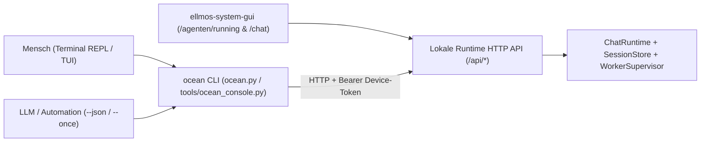

# OCEAN API + CLI Konsole (`ocean console` / `ocean chat`) — Architektur- & Umsetzungsplan

**Status:** Planung angelegt (2026-11-09)
**Bezug:** Regel 4 (`API + CLI + GUI` — Dual-Bedienbarkeit für Menschen und LLMs), analog zu `bach` CLI, `claude` (Claude Code) und `agy` (Antigravity CLI).

---

## 1. Zielbild & Grundprinzip (Dual API + CLI Contract)

Jede Funktion der OCEAN-Konsole wird gleichzeitig über zwei synchronisierte Wege bereitgestellt:

1. **Lokale HTTP/JSON-API** auf dem laufenden OCEAN-/BACH-Runtime-Server (Standardport `8810` bzw. `8000` im BACH-Core) mit identischen Request-/Response-Schemata für Web-GUI (`ellmos-system-gui`), CLI und andere Agenten.
2. **Kommandozeile & Interaktive Konsole (`ocean` CLI)** in `ocean.py` bzw. `tools/ocean_console.py`:
   - **Interaktiver REPL-/TUI-Modus** (`ocean chat` / `ocean console`) für Menschen im Terminal (mit Slash-Befehlen, Live-Tool-Ausgaben, Session-Wechsel und Agentenwahl).
   - **Nicht-interaktiver Single-Shot- & JSON-Modus** (`ocean chat --once "..." --json`, `ocean agents list --json`, `ocean sessions show <id> --json`) für LLMs, Skripte und Automationen.



---

## 2. Geplante CLI-Subkommandos (`ocean`)

Erweiterung von `ocean.py` um vier operative Subkommandos (ergänzend zu den bestehenden Lifecycle-Befehlen `up`, `start`, `down`, `status`, `inspect`, `gui`, `task`, `stack-status`):

### 2.1 `ocean chat` (Alias: `ocean console`)
Interaktive Terminal-Konsole (wie `claude` oder `agy`) sowie Single-Shot-Aufruf für Skripte/Agenten.

```bash
# Interaktive REPL-Session mit dem Standard-Agenten (buddha_chat) starten
ocean chat

# Direkt mit einem bestimmten Agenten oder Cloud-/Hintergrundworker chatten
ocean chat --agent worker-354b7ca0
ocean chat --agent buddha_always_on
ocean chat --agent entwickler

# Bestehende Session (Snapshot-ID) laden und nahtlos im Terminal fortsetzen (Fork / In-Place)
ocean chat --session 1842

# Single-Shot-Modus für LLMs, Pipelines und Shell-Skripte (optional mit --json)
ocean chat --agent recherche --once "Prüfe den aktuellen Status von Task #4047" --json
```

**Slash-Befehle innerhalb der interaktiven `ocean chat`-REPL:**
- `/agent <slot_or_worker_id>` — Wechselt den aktiven Gesprächspartner (Core-Profil oder Hintergrundworker).
- `/sessions [limit]` — Listet die letzten gespeicherten Sessions des aktuellen Agenten (`slot_id`-Filter).
- `/load <snapshot_id>` — Lädt ein gespeichertes Session-Transkript in die Konsole.
- `/fork [snapshot_id]` — Übernimmt eine geladene Worker-/Archiv-Session als neuen Direkt-Chat (`slot:<id>:<hex>`).
- `/resume [hinweis]` — Startet den Hintergrundworker mit deterministischem Übergabezettel (`_resume_zettel`) aus der aktuellen Session neu.
- `/tools [on|off]` — Schaltet die Anzeige von Tool-Aufrufen (`tool`-Rolle) im Terminal ein oder aus.
- `/status` — Zeigt Modellbindung, Anbieter (`ollama`, `ollama-cloud`, `openrouter`), Fackel-Besitz und Laufstatus des aktuellen Agenten.
- `/new` — Startet einen frischen Direkt-Chat-Strang (`slot:<id>:<32-hex>`).
- `/exit` / `Ctrl+D` — Beendet die Konsole sauber.

---

### 2.2 `ocean agents`
Agenten- und Hintergrundworker-Steuerung über das Terminal (exakt analog zu den Kacheln auf `/agenten/running`).

```bash
# Alle Core-Agenten und Hintergrundworker gruppiert nach Status (Bereit, Aktiv, Pausiert, Fehler) anzeigen
ocean agents list [--status ready|running|paused|error] [--json]

# Detailstatus inkl. Modellbindung, letzter Fehlermeldung und Rückgabe-Zähler
ocean agents show <agent_or_worker_id> [--json]

# Agenten/Worker starten, fortsetzen, pausieren oder stoppen
ocean agents start <id> [--json]
ocean agents resume <id> [--json]
ocean agents pause <id> [--json]
ocean agents stop <id> [--json]
```

---

### 2.3 `ocean sessions`
Session-Logs und Transkripte direkt im Terminal einsehen, durchsuchen oder an Worker übergeben.

```bash
# Sessions auflisten (optional gefiltert nach Agent/Worker, Quelle oder Problem-Flag)
ocean sessions list [--agent <slot_or_worker_id>] [--source user|buddha|worker|system] [--problems] [--limit 25] [--json]

# Vollständiges Transkript einer Session im Terminal ausgeben (inkl. Tool-Calls mit --tools)
ocean sessions show <snapshot_id> [--tools] [--json]

# Einen Hintergrundworker auf Basis einer Session + optionalem Hinweis fortsetzen
ocean sessions resume <snapshot_id> --worker <worker_id> [--prompt "Bitte ab Schritt 3 weitermachen"] [--json]
```

---

### 2.4 `ocean tasks` (Ausbau des bestehenden `ocean task`-Wrappers)
Direkte Anbindung an die Runtime-Task-API zusätzlich zum lokalen `taskplan`-Modul:

```bash
ocean tasks list [--status open|in_progress|done|blocked] [--assigned <agent_id>] [--json]
ocean tasks show <task_id> [--history] [--json]
ocean tasks assign <task_id> --agent <slot_or_worker_id> [--json]
ocean tasks returns [--hours 24] [--worker <worker_id>] [--json]
```

---

## 3. Zugehöriger HTTP-API-Vertrag (Dual API + CLI)

Alle `ocean`-CLI-Befehle nutzen ausschließlich die kanonischen HTTP-Endpunkte des Runtime-Servers (keine am Server vorbei geschriebenen SQLite-Mutationen):

| CLI-Befehl | HTTP-Methode & Pfad | Beschreibung |
|---|---|---|
| `ocean agents list` | `GET /api/system/core-agents` + `GET /api/system/workers` | Liefert Core-Profile und dynamische Hintergrundworker inkl. `runtime_verified`, `status`, `model`, `last_error`. |
| `ocean agents start/pause/stop` (Core) | `POST /api/system/core-agents/{id}/toggle` | Schaltet Core-Agenten (`{"enabled": true/false}`) mit Readback-Prüfung. |
| `ocean agents start/pause/stop` (Worker) | `POST /api/system/workers/{id}/{action}` | Führt `start`, `pause`, `stop`, `handoff`, `decompose` auf Hintergrundworkern aus. |
| `ocean sessions list` | `GET /api/agent-history/sessions?slot_id=<id>&source=...&problems=...` | Paginierte Session-Snapshots inkl. `slot_id`-Filter (`slot_filter` bestätigt). |
| `ocean sessions show <id>` | `GET /api/agent-history/sessions/{snapshot_id}?include_tools=true` | Einzelnes Session-Transkript inkl. optionaler `tool`-Nachrichten. |
| `ocean sessions resume <id>` | `POST /api/agent-history/sessions/{snapshot_id}/resume` | Übergabezettel (`_resume_zettel`) + optionaler `prompt`-Hinweis an `worker_id`. |
| `ocean chat` (Nachricht senden) | `POST /api/chat-control/chat` | Sendet `{"prompt": "...", "chat_id": "slot:<id>:<32-hex>"}` an Core-Slot oder dynamischen Worker. |
| `ocean chat --session <id>` (Fork) | `POST /api/chat-control/fork` | Kopiert `snapshot_id` in eine neue Direkt-Chat-Session `slot:<id>:<32-hex>`. |
| `ocean chat` (Live-Streaming, Phase 2) | `POST /api/chat-control/chat/stream` (SSE) | Server-Sent Events für Token-Streaming und Live-Tool-Call-Fortschritt in der Terminal-REPL. |

---

## 4. Authentifizierung & Verbindungsauflösung

Damit `ocean` sowohl lokal auf dem `mac-studio` als auch remote (z. B. via Tailscale von Windows/Workstation) ohne manuelle Token-Kopiererei funktioniert, löst `tools/ocean_api_client.py` Ziel-URL und Auth-Token deterministisch auf:

1. **Basis-URL (`OCEAN_API_URL`):**
   - Explizites Flag `--url <http://...>` oder Umgebungsvariable `OCEAN_API_URL`.
   - Falls ein `--workspace` angegeben ist: liest `<workspace>/state/runtime.json` (`url` / `port`).
   - Fallback lokal: prüft `http://127.0.0.1:8810` (OCEAN Default) und `http://127.0.0.1:8000` (BACH GUI Server).
2. **Device-/Control-Token (`OCEAN_API_TOKEN`):**
   - Umgebungsvariable `OCEAN_API_TOKEN` oder `BACH_CONTROL_API_TOKEN`.
   - Lokale Token-Dateien: `~/.ocean/device_token`, `~/.bach/gui_auth_token`, `~/.credentials/bach_control_api_token`.
   - Sendet `Authorization: Bearer <token>` sowie `X-BACH-Device-Token: <token>`.

---

## 5. Umsetzungsphasen (Meilensteine)

### Phase 1: `tools/ocean_api_client.py` & Read-Subkommandos (`ocean agents`, `ocean sessions`)
- **Umfang:**
  - HTTP-Client (`urllib.request` aus der Python-Standardbibliothek, null externe Pflichtabhängigkeiten) mit sauberer Fehlerübersetzung und `--json`-Ausgabe.
  - Implementierung von `ocean agents list|show|start|pause|stop` (gruppiert nach Status wie in der GUI) und `ocean sessions list|show|resume`.
- **Abnahme:** Unit-Tests in `tests/test_ocean_console_cli.py` gegen gemockten HTTP-Server + Live-Smoke-Test gegen `mac-studio`.

### Phase 2: Interaktive REPL `ocean chat` / `ocean console` (`tools/ocean_console.py`)
- **Umfang:**
  - Interaktive `readline`-basierte Terminal-REPL mit History (`~/.ocean/chat_history`), Slash-Befehlen (`/agent`, `/sessions`, `/load`, `/fork`, `/resume`, `/tools`, `/status`, `/new`, `/exit`) und Single-Shot-Modus (`--once`, `--json`).
  - Unterstützung für alle Core-Profile und alle Cloud-/Hintergrundworker (`slot:<id>:<32-hex>`).
- **Abnahme:** End-to-End-Tests für Single-Shot (`ocean chat --agent worker-354b7ca0 --once "..." --json`), Session-Fork (`--session <id>`) und REPL-Slash-Befehle.

### Phase 3: SSE-Live-Streaming & `ocean`-Binärbefehl im PATH
- **Umfang:**
  - Optionaler Streaming-Endpunkt `POST /api/chat-control/chat/stream` (Server-Sent Events), damit die Terminal-Konsole bei langen Tool-Ketten jeden Werkzeugaufruf (`[Werkzeug] start_task_worktree ...`) in Echtzeit anzeigt.
  - Bereitstellung von `ocean` / `ocean.cmd` im System-`PATH` (analog zu `agy` und `claude`).
